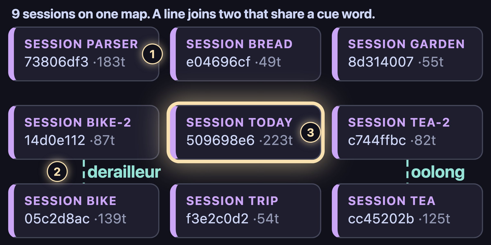
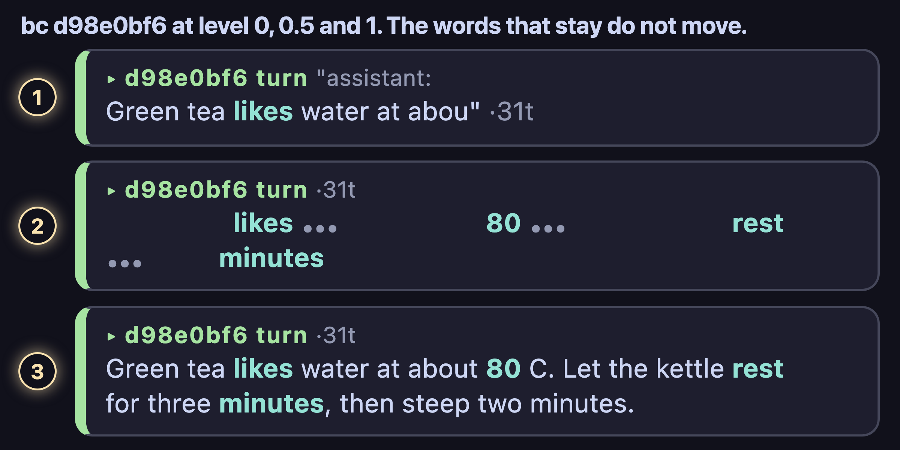
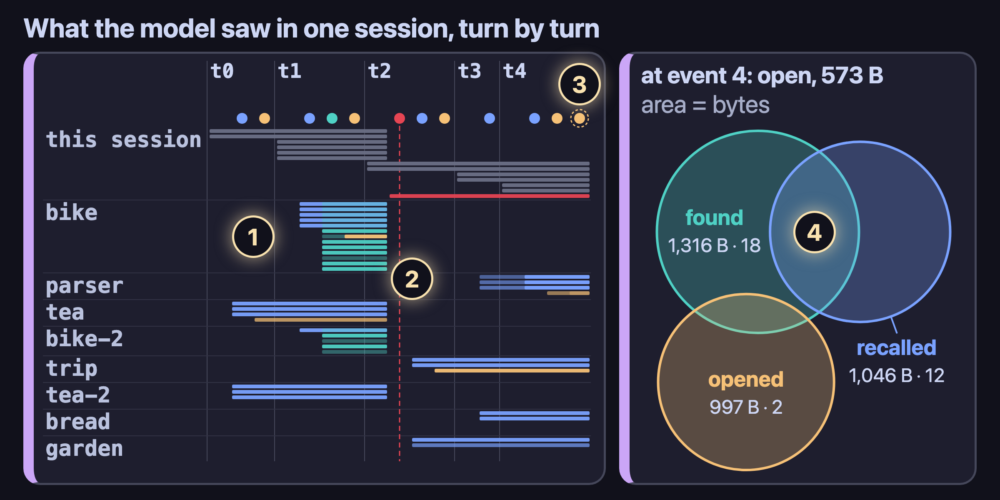

# The breadcrumbs demo

This page tells how to run the demo and what it shows, and it lists the films. The demo needs no model
and no network.

## Run it

```sh
python3 demo/seed.py /tmp/bc-demo                                  # a memory with neutral text
python3 -m breadcrumbs --home /tmp/bc-demo/breadcrumbs serve --open # the explorer, read-only
```

The seed writes eight past sessions (tea, bike, garden, a parser fix, a coast walk, bread) and one
session, `today`. In `today`, the agent recalls, finds, opens and compacts over four turns. A fifth
turn runs under a turn budget: the agent opens the parser session at level 0.3 and then at level 1,
and the budget cuts the second open. The times are fixed, so two runs give the same store.
`tests/test_demo.py` checks what the views show.

## What you see

**The map.** Each box is a session. A box's label is its first three cue words: the words that the
session uses more than the rest of the memory. Two sessions that share a cue word pull together, and
the line between them names the shared word (`oolong`, `derailleur`). A glow marks a session that
the agent opened.



**The zoom.** A click on a box opens its session as a document. Each user turn is a frame, headed by
what the user said. In the frame, the
prompt and the answers are cards, and each run of tool calls of one phase (explore, edit, verify,
delegate) is a band of tool cards. The files that the tools read and wrote are cards too, with a
line to each call that touched them. A click zooms to a frame, a band or a card. A card shows
`crumb(id, level)` at the level that its area can hold. Below level 1, a text shows key words: its
first line, then its most distinct words, then its meaningful words. Grammar words show only at
level 1. A `…` marks a gap; the gap expands to the exact text.



**The context.** Click "Context". The Gantt chart has one row for each crumb and one column for each
user turn. The head of each column gives what the user said in that turn. A bar is one copy of a crumb
in the model's context, and it shows the text that the model saw at the level of that copy. Its color
tells what put it there: gray is the session's own turns, blue is recall, teal is find, orange is open,
and red is the compaction (the red line marks it). A legend is at the top left. Under the head of each
turn, a chip names each event of the turn by its query or by the crumb that it opened. A dashed chip
marks an event that the turn budget cut: the last turn ran under a turn budget, and the budget cut
its second open. A click on a chip shows the Venn at that event. The Venn has one frame for each
region (found and recalled, found only, and so on), and each crumb in the region shows as its text.
A click on a bar, a chip or a crumb puts its text in the side panel and zooms the map to it. For a
chip, the side panel gives the exact context that the event gave the model. The context box stays on
its session until you click the map. The charts give no byte counts; `View.context` and `View.venn`
still give the bytes, for charts that draw them.



**The size.** Click "Size" (or put `#size=1` in the URL). The panel draws `ace.log`, the record that the
context engine writes for each request. A line chart shows what the chat holds, what ACE sent, the model's
own count and the target, with a dot on each fold. Candles show the sent size; a candle that ends lower is a
fold. A pie shows the parts of one request: the fixed part, the layer, the exact turns, and what is held back,
one crumb call away. A histogram shows how much each fold cut. Pills pick the selected session or the
current one. The seeded store has no `ace.log`, so the panel is empty there: it draws a profile that ran
with `context.engine breadcrumbs`.

## The films

| Film | What it shows |
|---|---|
| [To Scale](https://github.com/breadcrumbs-agency/hermes-breadcrumb-plugin/blob/media/to-scale.mp4) | Each measured head-to-head, each bar on one linear axis at its true ratio. |
| [One Tool, Two Parts](https://www.youtube.com/watch?v=a05N4Ju2-DM) | `crumb_find` and `crumb`, live on a demo memory. |
| [The First Explorer](https://www.youtube.com/watch?v=D3Mdd_eLjn8) | Each box is a session. Sessions that share a cue word pull together. |
